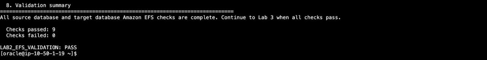
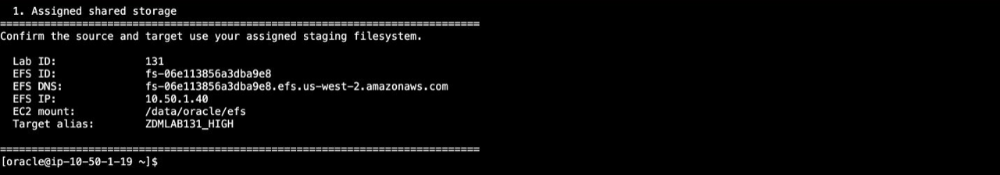
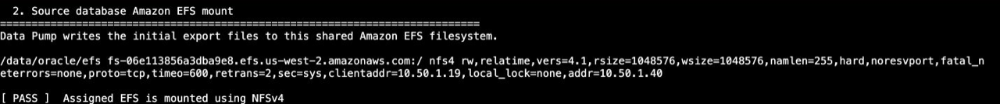
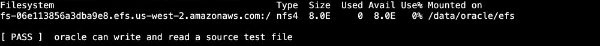
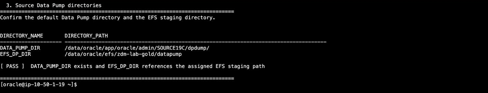
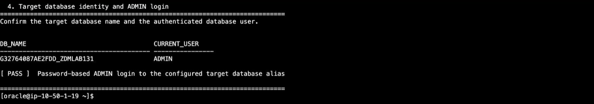
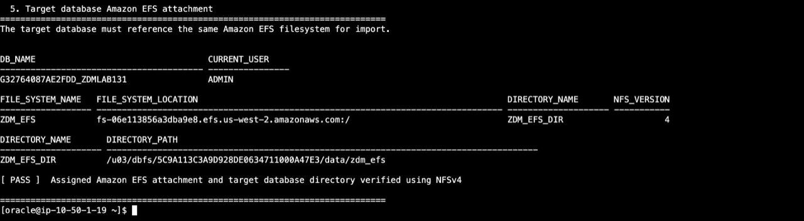
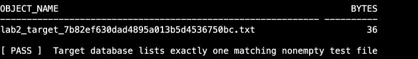
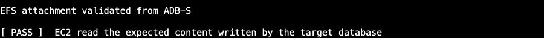

# Lab 2: Verify Amazon EFS Staging

## Introduction

Validate Amazon EFS storage from the source database EC2 instance and the target Autonomous AI Database. In the source database, inspect the default `DATA_PUMP_DIR` and the Amazon EFS staging directory `EFS_DP_DIR`. In the target database, validate the `ZDM_EFS_DIR` attachment. The EC2 mount and target database attachment must access the same Amazon EFS filesystem over NFSv4.

Estimated Time: 15 minutes

### Objectives

- Run the Amazon EFS validation script.
- Review the EC2 mount, target database attachment, and shared-file results.
- Automatically verify a target database file write, file listing, and read-back from EC2.

## Task 1: Run the Amazon EFS Readiness Check

1. In the `oracle` shell from Lab 1, run the script and save its formatted output.

    ```bash
    <copy>
    set -o pipefail
    umask 077
    bash "$HOME/lab2-efs-validation.sh" 2>&1 | tee "$HOME/lab2-efs-validation.log"
    </copy>
    ```

    The script loads your assigned environment, connects to the target database as `ADMIN`, and performs all storage checks automatically. No password input or separate SQL*Plus validation is required. It creates unique test files and removes only those files after checking them.

    **Connection note:** Continue in the same SSM Session Manager session. If disconnected, reconnect to your assigned EC2 instance through **Connect → Session Manager → Connect** in **US West (Oregon)** (`us-west-2`). If the session opens as `ssm-user`, run `sudo -iu oracle` before running the script above.

2. Confirm the final summary shows `9` passed checks, `0` failed checks, and `LAB2_EFS_VALIDATION: PASS`. You can then continue to **Lab 3**. Resolve any failed or timed-out checks before continuing.

    

3. **Optional:** Review the saved output to investigate a check. Use the arrow keys to scroll and press `q` to return to the shell.

    ```bash
    <copy>
    less -S "$HOME/lab2-efs-validation.log"
    </copy>
    ```

    Continue only when the final result is `LAB2_EFS_VALIDATION: PASS`. Resolve any failed or timed-out checks before starting migration.

## (Optional Task) Review Detailed Validation Output

If the Task 1 summary passed, you can continue directly to Lab 3. The examples below show one environment; your identifiers and unique test filename will differ.

**How the checks are counted:** The script performs **nine PASS checks across six validation sections**. Source mount, target file write/listing, and EC2 read-back/cleanup each contain two checks. The other three validation sections contain one check each. Assigned storage information and the final summary are not additional checks. Screenshot section numbers identify script sections, not check numbers.

**Assigned storage information:** Review your EFS ID, hostname, IP address, mount path, and target database alias before reviewing the checks.



1. **Check 1: Assigned Amazon EFS mount.** Confirm that the source database host has the assigned Amazon EFS filesystem mounted using NFSv4.

    

2. **Check 2: Source database host write and read.** Confirm that `oracle` can write and read a test file on Amazon EFS. This checks access to the source database staging location.

    

3. **Check 3: Source database Data Pump directories.** Confirm that `DATA_PUMP_DIR` exists and `EFS_DP_DIR` points to `/data/oracle/efs/zdm-lab-gold/datapump`.

    

4. **Check 4: Target database ADMIN login.** Confirm the password-based login to your configured target database alias succeeds. Review the database name and the `ADMIN` user.

    

5. **Check 5: Target database Amazon EFS attachment.** Confirm that `ZDM_EFS_DIR` references your assigned Amazon EFS filesystem using NFS version `4`.

    

6. **Check 6: Target database file write.** Confirm that the target database writes its unique test file through `ZDM_EFS_DIR`.

    

7. **Check 7: Target database file listing.** Confirm that `DBMS_CLOUD.LIST_FILES` returns exactly one matching test file with a nonzero byte count.

    

8. **Check 8: EC2 read-back of the target database file.** Confirm that EC2 reads `EFS attachment validated from ADB-S`. This verifies that the target database and source database host access the same shared file.

    

9. **Check 9: Test-file cleanup.** Confirm that the script removes only its own target test file and verifies that it is no longer visible.

    

**Final summary:** Require `9` passed checks, `0` failures, and `LAB2_EFS_VALIDATION: PASS`. No additional manual validation is required before Lab 3.


## Acknowledgements

* **Author** - Arnab Saha, Principal Solutions Architect, OCI Multicloud
* **Author** - Vineet Agarwal, Senior Principal Solutions Architect, OCI Multicloud
* **Last Updated By/Date** - Arnab Saha and Vineet Agarwal / October 11, 2026
