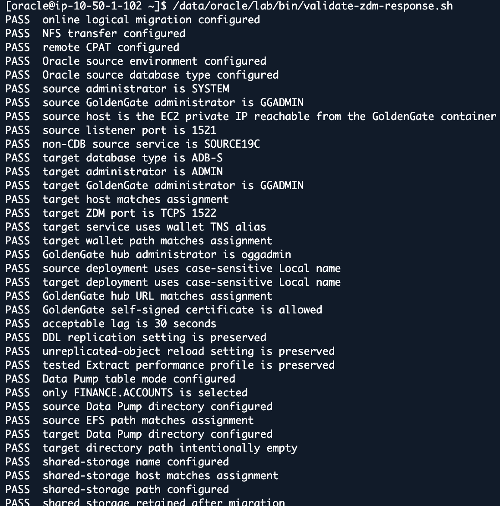
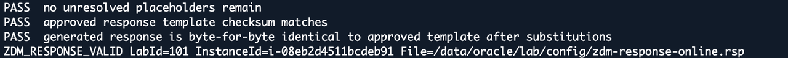
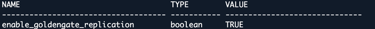
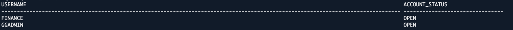
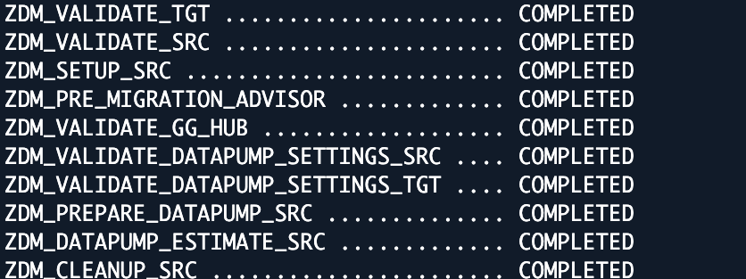

# Lab 3: Review and Evaluate the Online ZDM Migration

## Introduction

Review the ZDM response file and GoldenGate preparation in your environment, then run the ZDM evaluation process. ZDM coordinates the initial Data Pump transfer and GoldenGate replication. Evaluation checks readiness but does not perform the full export/import or prove end-to-end replication.

The ZDM response file contains your migration settings: the source database and target database connections, the table to migrate, Amazon EFS storage, and the GoldenGate configuration. ZDM reads this file during evaluation and migration so it uses the correct resources and migration method.

Estimated Time: 20 minutes

For background, see the [ZDM overview](https://www.oracle.com/database/zero-downtime-migration/) and [ZDM CLI command reference](https://docs.oracle.com/en/database/oracle/zero-downtime-migration/26.1/zdmug/zero-downtime-migration-zdmcli-command-reference.html).

### Objectives

Review the ZDM and GoldenGate configuration, confirm target database readiness, and complete the ZDM evaluation process.

## Task 1: Review the ZDM and GoldenGate Configuration

1. Continue in the `oracle` shell and load the source database, ZDM, and assigned environment variables. If you reconnected through SSM Session Manager as `ssm-user`, run `sudo -iu oracle` first.

    ```bash
    <copy>
    source "$HOME/env/source19c.env"
    source /etc/profile.d/zdm26.sh
    source /data/oracle/lab/config/lab-env.sh
    export ZDMCLI="$ZDM_HOME/bin/zdmcli"
    export ZDM_SOURCE_SSH_KEY="$HOME/.ssh/zdm_source_ed25519"
    </copy>
    ```

2. Display the ZDM migration method, included object, GoldenGate deployment names, and target database service.

    ```bash
    <copy>
    grep -E '^(MIGRATION_METHOD|DATA_TRANSFER_MEDIUM|INCLUDEOBJECTS-1|GOLDENGATEHUB_(SOURCE|TARGET)DEPLOYMENTNAME|TARGETDATABASE_CONNECTIONDETAILS_SERVICENAME)=' "$ZDM_RESPONSE_FILE"
    </copy>
    ```

    Expect `ONLINE_LOGICAL`, `NFS`, `FINANCE.ACCOUNTS`, and the case-sensitive deployment name `Local`. The target database alias is specific to your assigned environment.

3. Review the response-file settings below. The validator in Step 4 checks the full configuration, including settings not printed by Step 2:

    - `MIGRATION_METHOD=ONLINE_LOGICAL` and `DATA_TRANSFER_MEDIUM=NFS`. Keep the literal value `NFS`: ZDM uses it for the protocol through which it accesses Amazon EFS.
    - Only `FINANCE.ACCOUNTS` included in TABLE mode.
    - Source database users `SYSTEM` and `GGADMIN`; target database users `ADMIN` and `GGADMIN`; GoldenGate hub user `oggadmin`.
    - Case-sensitive `Local` for both deployment names.
    - Source database host reachable from the GoldenGate container.
    - Target database ZDM wallet alias on port 1522.
    - Source database directory `DATA_PUMP_DIR_NFS`, target database directory `ZDM_EFS_DIR`, assigned Amazon EFS hostname, and retained Amazon EFS storage. Preserve these directory object names exactly as configured.
    - Approved lag, DDL, performance, and dump-retention settings unchanged.

    The validator compares the generated file with the approved template after assignment substitutions. Do not add tablespace remapping, change usernames, or loosen TLS settings to bypass a failure.

4. Run the response-file validator in the `oracle` shell.

    ```bash
    <copy>
    /data/oracle/lab/bin/validate-zdm-response.sh
    </copy>
    ```

    

    The screenshots show sample output from the command above. `ZDM_RESPONSE_VALID` is the success marker.

    

## Task 2: Confirm the ZDM and GoldenGate Target Database Preparation

The target database accounts are already prepared. The target database TLS wallet is already installed for ZDM. ZDM prompts for credentials at runtime; SQL*Plus uses the password-authenticated alias from `adbs.env`.

1. From the `oracle` shell, check connectivity to the assigned target database.

    ```bash
    <copy>
    source "$HOME/env/adbs.env"
    "$ORACLE_HOME/bin/tnsping" "$TARGET_ALIAS"
    </copy>
    ```

2. Connect to the target database as `ADMIN`. When `Enter password:` appears, enter **Target ADMIN Password** from your reservation information. Password input is not displayed.

    ```bash
    <copy>
    sqlplus -L ADMIN@"$TARGET_ALIAS"
    </copy>
    ```

3. After connecting, check the target database state and GoldenGate replication setting.

    ```sql
    <copy>
    SET LINESIZE 220
    SET PAGESIZE 100
    SELECT name, open_mode FROM v$database;
    SHOW PARAMETER enable_goldengate_replication
    </copy>
    ```

    Confirm the target database is `READ WRITE` and `enable_goldengate_replication` is `TRUE`. The screenshot shows the replication setting.

    

4. Check the target database users and their account status.

    ```sql
    <copy>
    SELECT username, account_status FROM dba_users
    WHERE username IN ('GGADMIN','FINANCE') ORDER BY username;
    </copy>
    ```

    Confirm both `GGADMIN` and `FINANCE` are `OPEN`. GoldenGate uses `GGADMIN` for the target replication connection; `FINANCE` owns the migrated table.

    

5. Check that the target database `FINANCE` schema does not contain an `ACCOUNTS` table before the first migration.

    ```sql
    <copy>
    SELECT owner, table_name FROM dba_tables
    WHERE owner='FINANCE' AND table_name='ACCOUNTS';
    PROMPT If no rows are selected, continue to the evaluation steps. Otherwise, review the target-table note below.
    </copy>
    ```

    Expect `no rows selected` for a fresh target database.

    **Note:** If a row is returned, drop the existing table on your assigned **target database** as `ADMIN` before evaluation. This removes the table and its data; do not run it on the source database.

    ```sql
    <copy>
    DROP TABLE finance.accounts;
    </copy>
    ```

6. Exit SQL*Plus to return to the `oracle` shell.

    ```sql
    <copy>
    EXIT
    </copy>
    ```

## Task 3: Run the ZDM Evaluation Process

Allow approximately **5–10 minutes** for evaluation. This is a planning estimate, not a timeout; completion can take longer. Continue based on the job status, not elapsed time.

1. Back at the `oracle` shell, reload the source database environment variables after the target database SQL check.

    ```bash
    <copy>
    source "$HOME/env/source19c.env"
    source /etc/profile.d/zdm26.sh
    source /data/oracle/lab/config/lab-env.sh
    export ZDMCLI="$ZDM_HOME/bin/zdmcli"
    export ZDM_SOURCE_SSH_KEY="$HOME/.ssh/zdm_source_ed25519"
    </copy>
    ```

2. Submit the ZDM evaluation from the `oracle` shell to check the source database, target database, Data Pump settings, and GoldenGate hub readiness.

    ```bash
    <copy>
    bash "$HOME/zdm-submit-once.sh" --eval
    </copy>
    ```

    The helper runs `zdmcli migrate database` with `-eval` using your assigned environment and response file. It evaluates readiness without starting the migration.

3. At `Shared ZDM password (input hidden):`, enter the shared ZDM password from your reservation information once. Input is hidden. The helper supplies it to the five ZDM prompts: source database `SYSTEM` and `GGADMIN`, target database `ADMIN` and `GGADMIN`, and GoldenGate hub `oggadmin`. These five accounts must use the same password. The helper does not store the password in its script or pass it as a command-line argument.

    ZDM prints the job ID when it schedules your evaluation. Record this ID: it identifies your evaluation and is important for monitoring its progress and locating its results. Your ID may differ from the screenshot.

4. Replace `<JOB_ID>` (including the brackets) with the evaluation job ID printed in the previous step. Keep this evaluation ID separate from the migration job ID that you will receive in Lab 4.

    ```bash
    <copy>
    export EVAL_JOB_ID="<JOB_ID>"
    </copy>
    ```

    If you reconnect, switch to `oracle`, reload the environment from Step 1, and set `EVAL_JOB_ID` again to the existing evaluation job ID. Do not submit another evaluation just to monitor it.

    Run this separate block to check the evaluation every **30 seconds**. When the output reports `SUCCEEDED`, press **Ctrl+C** and continue to Step 5. If it reports `FAILED`, stop the loop and review the reported error. Ctrl+C stops monitoring, not the ZDM job.

    ```bash
    <copy>
    while true; do
      printf '\nChecking evaluation job %s at %s\n' "$EVAL_JOB_ID" "$(date)"
      "$ZDMCLI" query job -jobid "$EVAL_JOB_ID" || break
      printf '\nRefresh in 30 seconds. On SUCCEEDED, press Ctrl+C and review the evaluation results.\n'
      sleep 30
    done
    </copy>
    ```

    

5. Proceed only when your selected evaluation job reports `SUCCEEDED`. Review CPAT findings and the excluded-objects file: ACCOUNTS must not be excluded from the required migration/replication scope. Save the actual result-log path from your output.

    Completed prerequisite phases from the same evaluation:

    

    This example is job type `EVAL`, not the actual migration. It does not prove Data Pump import or GoldenGate replication has completed.

    For failures, report the first failed phase and the corresponding log error. Do not skip validation or submit repeated migration jobs.

## Acknowledgements

* **Author** - Arnab Saha, Principal Solutions Architect, OCI Multicloud
* **Author** - Vineet Agarwal, Senior Principal Solutions Architect, OCI Multicloud
* **Last Updated By/Date** - Arnab Saha and Vineet Agarwal / October 8, 2026
