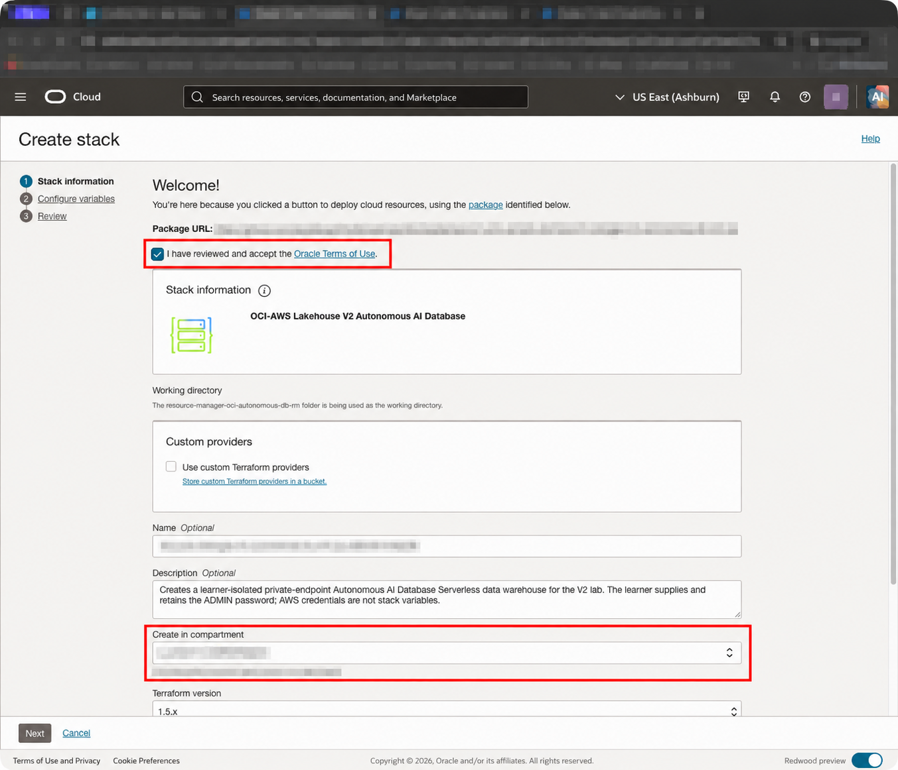
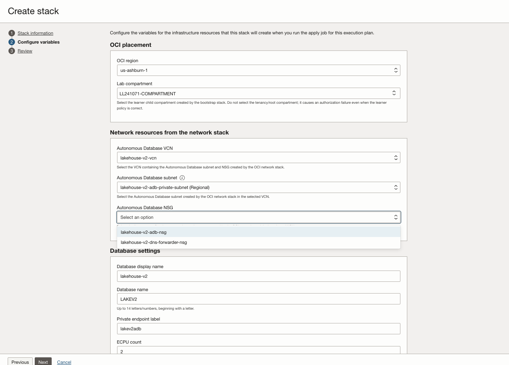

# Create Autonomous AI Lakehouse

## Introduction

In this module, you create an Autonomous AI Lakehouse with a private endpoint in the OCI subnet prepared for the lab.

Estimated Time: 15 minutes

### Objectives

* Deploy the Autonomous AI Lakehouse stack with Resource Manager.
* Verify the private endpoint, subnet, and network security group.
* Open Database Actions and sign in as `ADMIN`.

## Task 1: Create and apply the Autonomous AI Lakehouse stack

1. Select **Deploy to Oracle Cloud** to open Resource Manager.

    <a class="tryit-button" href="https://cloud.oracle.com/resourcemanager/stacks/create?region=us-ashburn-1&amp;zipUrl=https%3A%2F%2Fgithub.com%2Foracle-livelabs%2Fmulticloud%2Fraw%2Frefs%2Fheads%2Fmain%2Foci_aws_private_s3%2Fresource-manager-oci-autonomous-db-rm.zip" target="_blank" rel="noopener noreferrer" style="display: inline-block; width: auto;">Deploy to Oracle Cloud</a>

2. On **Stack information**, select the **I have reviewed and accept the Oracle Terms of Use** checkbox. Wait for the stack title and description to appear.

    

3. Under **Create in compartment**, confirm that your assigned lab compartment is selected, then select **Next**.

4. On the **Configure variables** page, update the following values. The **Lab compartment**, **Autonomous Database VCN**, **Autonomous Database subnet**, and **Autonomous Database NSG** fields are selectors: choose the resources by name from their drop-down lists. You do not need to provide any resource OCIDs.

    

    | Console field | What to select or enter |
    | --- | --- |
    | **OCI region** | Your assigned OCI region. |
    | **Lab compartment** | Select your assigned lab compartment. Do not select the tenancy/root compartment. |
    | **Autonomous Database VCN** | Select the VCN created by the OCI network stack in your lab compartment. This filters the next two selectors. |
    | **Autonomous Database subnet** | Select the private subnet with **`DB`** in its name. |
    | **Autonomous Database NSG** | Select the network security group with **`DB`** in its name. |
    | **Database display name** | A descriptive database name. Keep the supplied default or use the lab naming convention. |
    | **Database name** | The database name, beginning with a letter and containing no more than 14 letters or numbers. Keep the supplied default unless instructed otherwise. |
    | **Private endpoint label** | A private endpoint label. Keep the supplied default unless instructed otherwise. |
    | **Allowed public client CIDR** | Your workstation public egress IP in `/32` form, or an approved corporate/VPN CIDR. On a Mac, open **Terminal** and run `curl ifconfig.me`; append `/32` to the returned IP. On Windows, open **Command Prompt**, run `ipconfig`, find the **IPv4 Address** for the active network adapter, and append `/32`. If Windows shows a private address such as `10.x.x.x` or `192.168.x.x`, obtain the public egress CIDR from your network administrator. Do not use `0.0.0.0/0`. |
    | **ECPU count** and **Storage in TB** | Keep the lab-supplied defaults unless your instructor provides different values. |
    | **ADMIN password** | Create and confirm a new password for the `ADMIN` user, then save it securely for Database Actions. It must meet all of these conditions: 1. Be 12–30 characters long (30 characters maximum) and include at least one uppercase letter, lowercase letter, and numeric character. 2. Not contain the username (`ADMIN`). 3. Not contain a double quotation mark (`"`) or single quotation mark (`'`). |

5. Select **Next**. On the **Review** page, review the configuration, leave **Run apply** selected, then select **Create**. Do not change the Terraform configuration or provider settings.

6. Open the apply job that Resource Manager starts automatically. The Autonomous AI Lakehouse creation can take several minutes.

7. Monitor the apply job until it completes.

    

8. Continue only when the apply job status is **Succeeded**. If it fails, open the job, review its logs, correct the input identified in the error, and run **Apply** again.

    

## Task 2: Verify the private endpoint and open Database Actions

1. From the OCI Console navigation menu, open **Oracle Database** → **Autonomous AI Lakehouse**. Set the **Compartment** selector to your assigned lab compartment, then select the Autonomous AI Lakehouse created by the stack.

    

2. On the details page, confirm that the private endpoint, private endpoint IP, subnet, and NSG are populated.

3. Select the **Tool configuration** tab. In the **Database Actions** section, locate the **Public access URL**. Open this URL in your browser; it lets you use Database Actions from your workstation while the database's outbound connection remains private.

    

4. At the Database Actions sign-in page, enter `ADMIN` as the username and the ADMIN password you set in Task 1, then sign in.

    

## Summary

You created an Autonomous AI Lakehouse in the private OCI subnet.

## Acknowledgements

* **Author** - Arun Ramakrishnan
* **Last Updated By/Date** - Arun Ramakrishnan, October 2026
