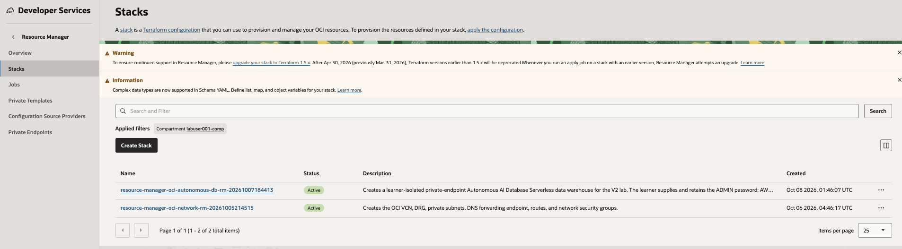
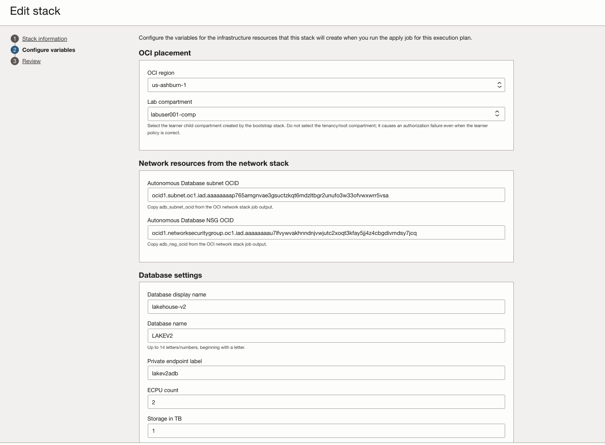
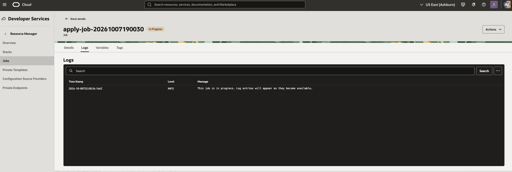
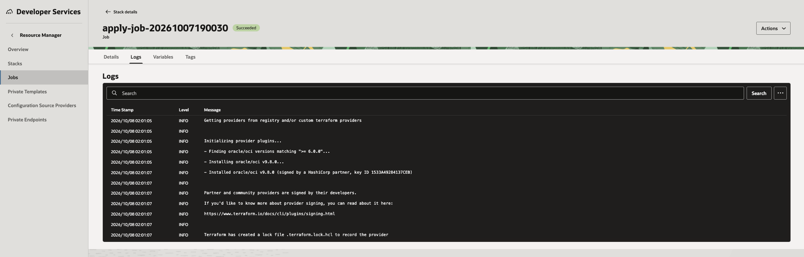
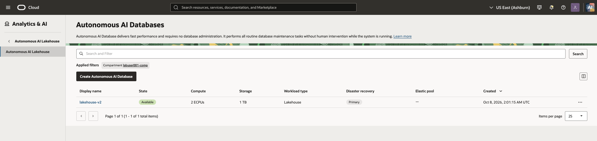
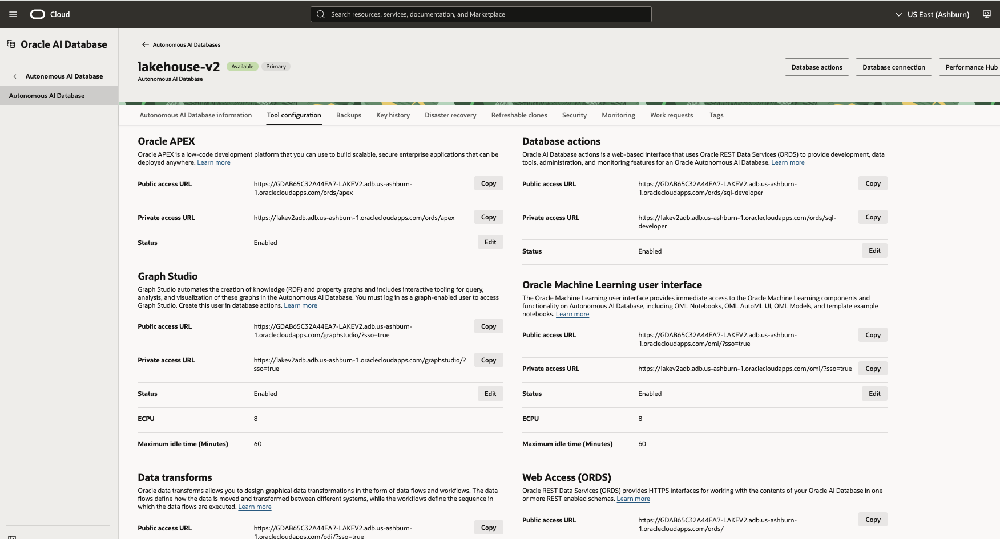
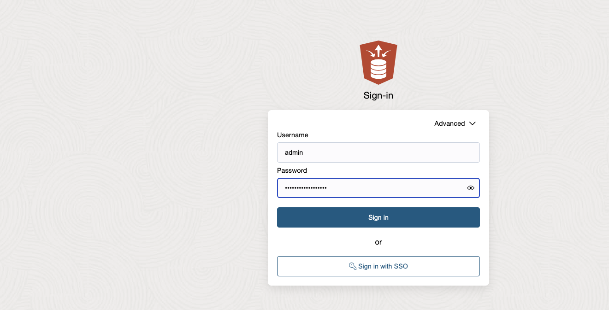

# Create Autonomous AI Lakehouse

## Introduction

In this module, you create an Autonomous AI Lakehouse with a private endpoint in the OCI subnet prepared for the lab.

Estimated Time: 15 minutes

## Task 1: Create and apply the Autonomous AI Lakehouse stack

1. Select **Deploy to Oracle Cloud** to open Resource Manager with the Autonomous AI Lakehouse stack configuration loaded.

    

2. If prompted, sign in to your assigned OCI tenancy. Confirm that the console region is **US East (Ashburn)**.

3. On the **Create stack** page, confirm that the `resource-manager-oci-autonomous-db-rm.zip` configuration is already selected.

    

4. Enter a stack name, such as **`resource-manager-oci-autonomous-db-rm`**, select your assigned lab compartment, then select **Next**.

5. On the **Configure variables** page, update the following values. The `Lab compartment`, `Autonomous Database VCN`, `Autonomous Database subnet`, and `Autonomous Database NSG` fields are selectors: choose the resources by name from their drop-down lists rather than pasting OCIDs.

    

    | Stack variable | What to select or enter |
    | --- | --- |
    | `region` | Your assigned OCI region. |
    | `compartment_ocid` (**Lab compartment**) | Select your assigned lab compartment. Do not select the tenancy/root compartment. |
    | `adb_vcn_ocid` (**Autonomous Database VCN**) | Select the VCN created by the OCI network stack in your lab compartment. This filters the next two selectors. |
    | `adb_subnet_ocid` (**Autonomous Database subnet**) | Select the private subnet with **`DB`** in its name. Do not paste a subnet OCID. |
    | `adb_nsg_ocid` (**Autonomous Database NSG**) | Select the network security group with **`DB`** in its name. Do not paste an NSG OCID. |
    | `display_name` | A descriptive database name. Keep the supplied default or use the lab naming convention. |
    | `db_name` | The database name, beginning with a letter and containing no more than 14 letters or numbers. Keep the supplied default unless instructed otherwise. |
    | `private_endpoint_label` | A private endpoint label. Keep the supplied default unless instructed otherwise. |
    | `public_access_cidr` | Your workstation public egress IP in `/32` form, or an approved corporate/VPN CIDR. Do not use `0.0.0.0/0`. |
    | `ecpu_count` and `storage_tbs` | Keep the lab-supplied defaults unless your instructor provides different values. |
    | `admin_password` | Create and confirm a new strong password for the `ADMIN` user. Save it securely; you use it to sign in to Database Actions. |

6. Select **Next**. On the **Review** page, review the configuration, leave **Run apply** selected, then select **Create**. Do not change the Terraform configuration or provider settings.

7. Open the apply job that Resource Manager starts automatically. The Autonomous AI Lakehouse creation can take several minutes.

8. Monitor the apply job until it completes.

    

9. Continue only when the apply job status is **Succeeded**. If it fails, open the job, review its logs, correct the input identified in the error, and run **Apply** again.

    

## Task 2: Verify the private endpoint and open Database Actions

1. From the OCI Console navigation menu, open **Oracle Database** → **Autonomous AI Lakehouse**. Set the **Compartment** selector to your assigned lab compartment, then select the Autonomous AI Lakehouse created by the stack.

    

2. On the details page, confirm that the private endpoint, private endpoint IP, subnet, and NSG are populated.

3. Select the **Tool configuration** tab. In the **Database Actions** section, locate the **Public access URL**. Open this URL in your browser; it lets you use Database Actions from your workstation while the database's outbound connection remains private.

    

4. At the Database Actions sign-in page, enter `ADMIN` as the username and the `admin_password` you set in Task 1, then sign in.

    

## Summary

You created an Autonomous AI Lakehouse in the private OCI subnet.
