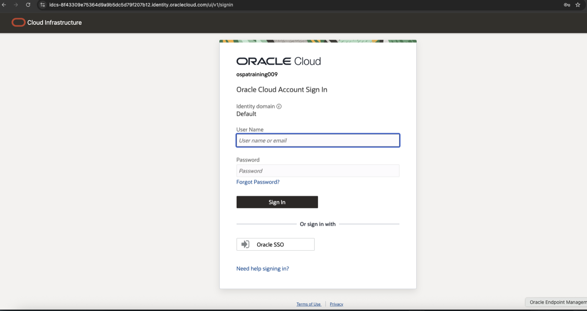
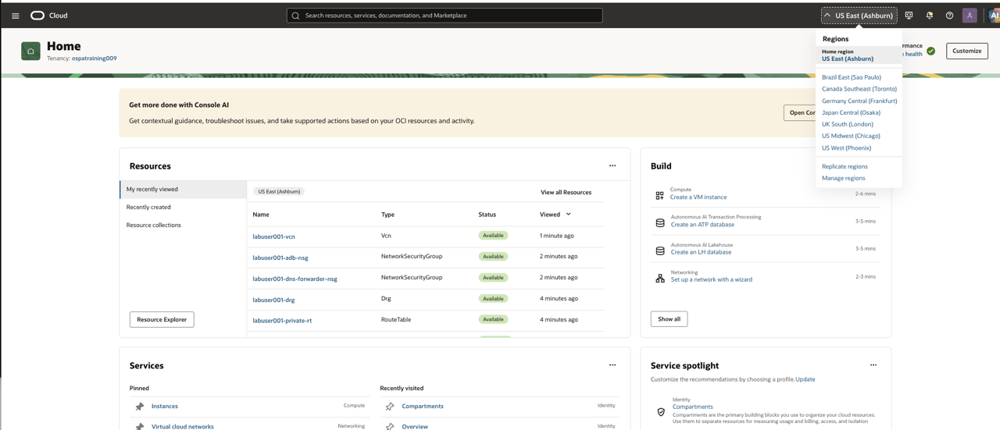
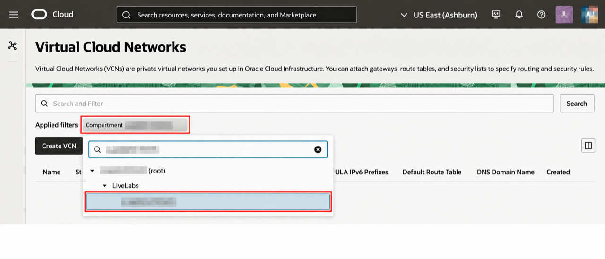
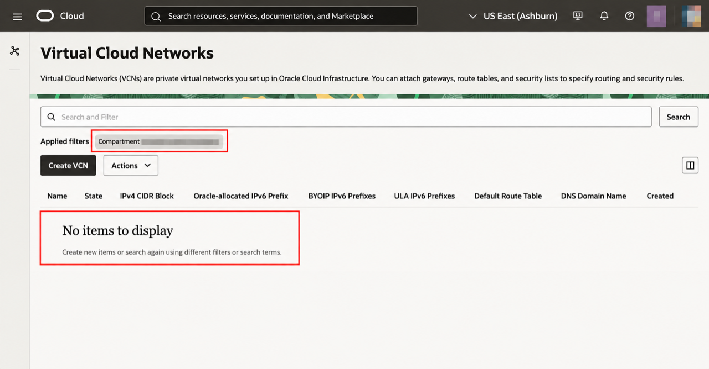

# OCI Event Account

## Introduction

In this module, you sign in to OCI and select the compartment and Region assigned to your lab.

Estimated Time: 5 minutes

### Objectives

* Sign in to OCI and select US East (Ashburn), `us-ashburn-1`.
* Select your assigned learner compartment and verify that it has no virtual cloud network.

## Task 1: Sign in to OCI

1. Open the OCI console URL supplied by the instructor.
2. Sign in with your assigned Identity Domain user.

    

3. Select **US East (Ashburn)** from the Region menu. Confirm the Region is `us-ashburn-1`.

    

4. Open the **Navigation menu (☰)** and select **Networking → Virtual cloud networks**. Under **Applied filters**, open **Compartment** and select your assigned learner compartment. Find its name under **View Login Info** in LiveLabs. Do not select the tenancy/root compartment.

    

5. Verify that the network list shows **No items to display**. This confirms that no virtual cloud network exists in your selected compartment before you deploy the network stack.

    

    Keep this Console tab open while you continue the lab. If you close and reopen your incognito/private window, repeat steps 4 and 5.

## Summary

You are working in the correct OCI Region and learner compartment and have confirmed that the network has not been created yet.

## Acknowledgements

* **Author** - Arun Ramakrishnan
* **Last Updated By/Date** - Arun Ramakrishnan, October 2026
