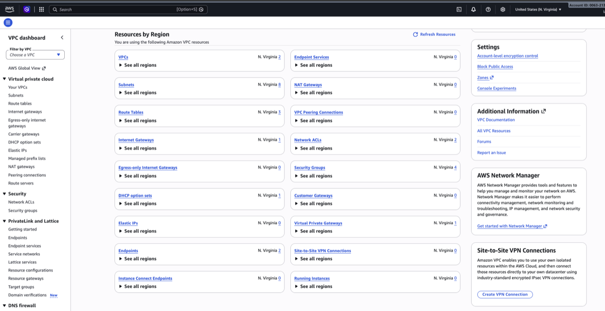
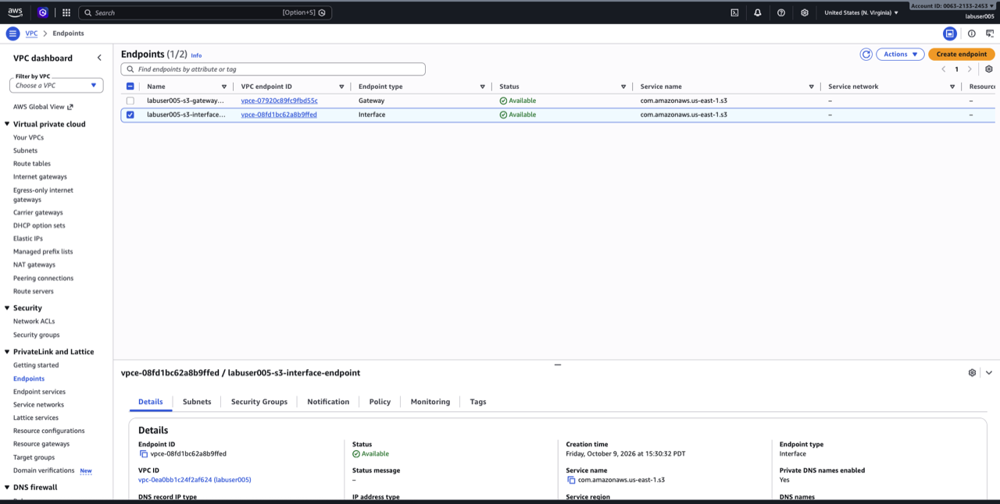
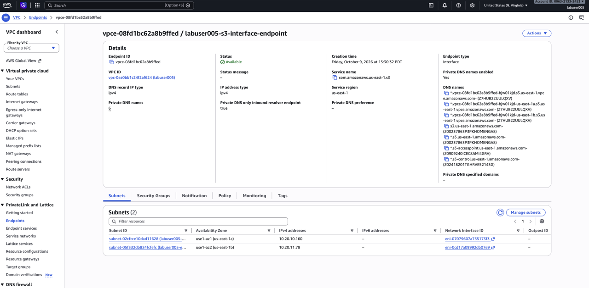

# Verify AWS Lab Environment

## Introduction

The instructor pre-stages the AWS foundation. In this module, you inspect the S3 data source and the AWS private-network components used by the lab.

Estimated Time: 10 minutes

### Objectives

* Verify the lab S3 bucket and sample CSV objects.
* Inspect the lab VPC and S3 Interface Endpoint.
* Validate the Route 53 Resolver inbound IP addresses for OCI DNS forwarding.

## Task 1: Verify the S3 data source

1. Open **S3** from the AWS Services menu.

    

2. Select the lab bucket assigned by the instructor.

    

3. Open the `retail/` prefix.
4. Confirm that `orders_2026_01.csv` and `orders_2026_02.csv` are present.
5. Open one file and confirm it contains CSV order data.

    

## Task 2: Verify private S3 and DNS components

1. Open the AWS Services menu, search for **VPC**, and select **VPC**.

    

2. In the VPC console navigation pane, select **Your VPCs**. Select the lab VPC assigned by the instructor.

    

3. Open the VPC details page and select the **Resource map** or **Related resources** view.

    

4. In the related resources, locate and select the **Route 53 Resolver endpoint** associated with the lab VPC.

    

5. Confirm that the endpoint direction is **Inbound** and that its private IP addresses are listed. One of these IP addresses is used as an input when you create the VCN and other OCI network resources later in the lab. The OCI network stack configures DNS forwarding to this Route 53 Resolver inbound IP so S3 DNS queries can resolve to the AWS Interface endpoint's private addresses and travel over the Oracle–AWS Interconnect rather than the public internet.

    You do not need to copy the IP address now. The value to use is provided in your LiveLabs session login information.

    

6. In the VPC console navigation pane, under **Virtual private cloud**, select **Endpoints**.

    

    Use the **VPC ID** filter to show only endpoints in your lab VPC, then select the endpoint whose service name is the regional Amazon S3 service—for example, `com.amazonaws.us-east-1.s3`.

    

    Confirm all of the following on the endpoint details page:

    

    * **Type** is **Interface**.
    * **Private DNS** is enabled.
    * The endpoint belongs to the lab VPC and has network interfaces in the expected lab subnets.

    The endpoint must be an **Interface** endpoint because it creates private network interfaces (ENIs) and private IP addresses for the S3 service inside the AWS VPC. With Private DNS enabled, the S3 DNS name resolves to those private addresses. OCI can then forward the S3 DNS query to the Route 53 Resolver and reach S3 through the Oracle–AWS Interconnect.

    Do not confuse this with an S3 **Gateway** endpoint. Gateway endpoints provide private S3 access only from resources inside the AWS VPC; they do not create private endpoint IP addresses that OCI can reach across the Interconnect. An Interface endpoint is therefore required for this lab's private OCI-to-S3 data path.

## Summary

You verified the pre-staged AWS S3 data, private endpoint, DNS resolver, and Direct Connect gateway.

## Acknowledgements

* **Author** - Arun Ramakrishnan
* **Last Updated By/Date** - Arun Ramakrishnan, October 2026
