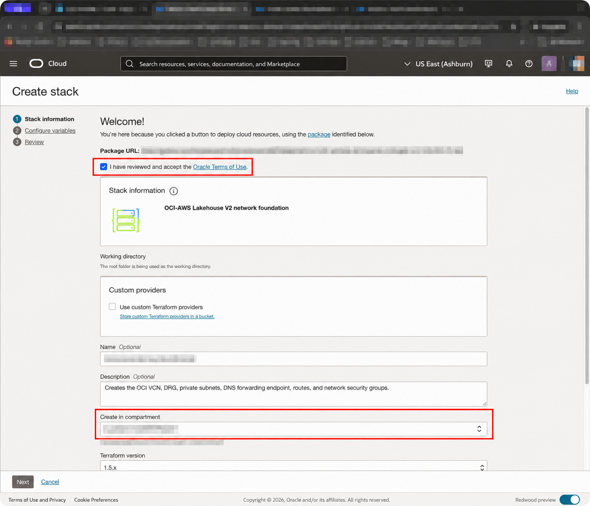
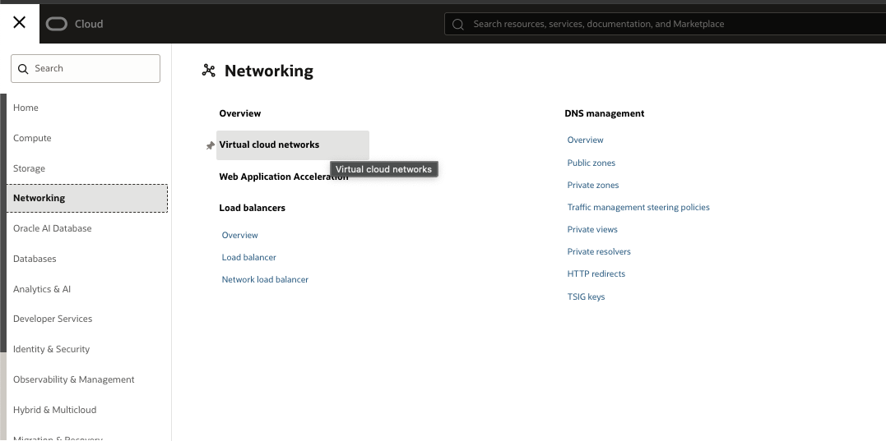
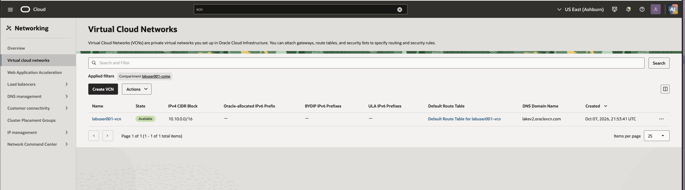
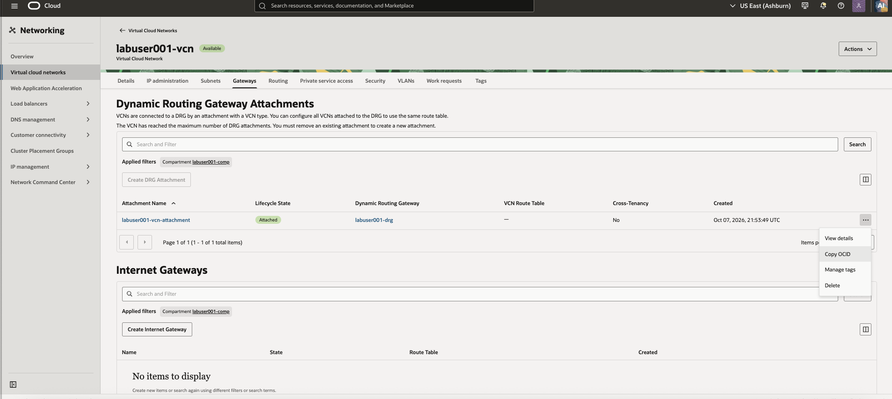
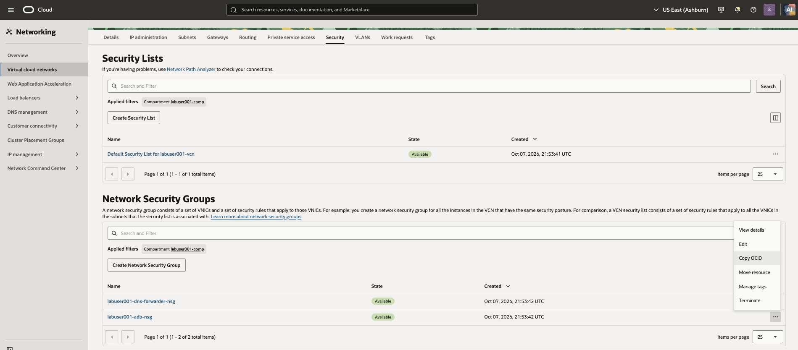
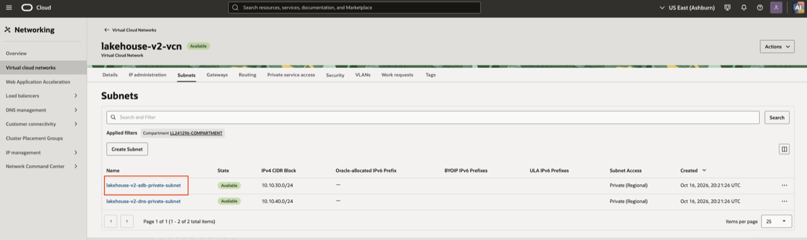

# Verify OCI Lab Environment

## Introduction

In this module, you deploy the OCI network foundation into your assigned lab compartment, then record the values needed to create the Interconnect and Autonomous AI Lakehouse. The network stack creates the VCN, private subnets, network security groups (NSGs), route tables, DRG, and DNS forwarding configuration.

Estimated Time: 20 minutes

## Task 1: Create and deploy the OCI network stack

1. Select **Deploy to Oracle Cloud** to open Resource Manager.

    <a class="tryit-button" href="https://cloud.oracle.com/resourcemanager/stacks/create?region=us-ashburn-1&amp;zipUrl=https%3A%2F%2Fgithub.com%2Fdavidastart%2Fmulticloud%2Fraw%2Frefs%2Fheads%2Fmain%2Foci_aws_private_s3%2Fresource-manager-oci-network-rm.zip" target="_blank" rel="noopener noreferrer" style="display: inline-block; width: auto;">Deploy to Oracle Cloud</a>

2. On **Stack information**, select the **I have reviewed and accept the Oracle Terms of Use** checkbox. Wait for the stack title and description to appear.

    

3. Under **Create in compartment**, confirm that your assigned lab compartment is selected, then select **Next**.

4. On the **Configure variables** page, enter the values supplied for you in the LiveLabs portal by the lab administrator. Use your assigned values rather than values from another learner.

   | Variable | What to enter |
   | --- | --- |
   | `region` | Your assigned OCI region. |
   | `compartment_ocid` | The OCID of **your lab compartment**, not the tenancy OCID. |
   | `name_prefix` | Your assigned lab name prefix, if one is provided. |
   | `vcn_cidr`, `adb_subnet_cidr`, `dns_subnet_cidr` | The OCI CIDR ranges supplied in the portal. Keep the provided defaults only when the portal instructs you to do so. |
   | `aws_vpc_cidr` | The CIDR of your assigned AWS lab VPC. |
   | `aws_resolver_inbound_ip` | One private IP address of the Route 53 Resolver **inbound** endpoint. Find this value in the administrator-supplied values in the LiveLabs portal. This lets OCI forward S3 DNS queries to AWS through the private path. |
   | `s3_dns_domain` | `s3.us-east-1.amazonaws.com`, unless the portal supplies a different value. |
   | `admin_client_cidr` | The administrator workstation or VPN CIDR supplied in the portal, for example `203.0.113.25/32`. Do not use `0.0.0.0/0`. |

5. Select **Next**. On the **Review** page, review the configuration, leave **Run apply** selected, then select **Create**.

6. Open the apply job that Resource Manager starts automatically. Wait for the job status to show **Succeeded** before continuing. If the job fails, open the job, review its logs, correct the input identified in the error, and run **Apply** again.

## Task 2: Inspect the OCI network and record OCIDs

1. From the OCI Console navigation menu, open **Networking** → **Virtual cloud networks**.

    

2. Confirm that the compartment selector is set to your assigned lab compartment. Select the VCN created by the network stack.

    

3. On the VCN details page, select **Gateways**. Confirm the Dynamic Routing Gateway (DRG) created for the lab is attached and available. Open the DRG, use **Actions** → **Copy OCID**, and save the value as `drg_ocid` for the Interconnect module.

    

4. Select **Security** → **Network security groups**. Confirm that the Autonomous AI Lakehouse NSG is present. Open the NSG, use **Actions** → **Copy OCID**, and save the value as `adb_nsg_ocid` for the Autonomous AI Lakehouse module.

    

5. Select **Subnets**. Confirm that the Autonomous Database subnet is private and has the expected CIDR. Open the subnet, use **Actions** → **Copy OCID**, and save the value as `adb_subnet_ocid` for the Autonomous AI Lakehouse module. Open its route table and confirm that the AWS VPC CIDR route targets the DRG.

    

## Summary

Your OCI network foundation, DRG, private subnet, NSG, and DNS forwarding configuration are ready. You have also saved the DRG, NSG, and subnet OCIDs required by the Autonomous AI Lakehouse stack.
